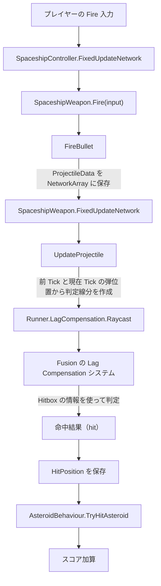

# Fusion-Asteroids：HitboxManager と SpaceshipWeapon の当たり判定処理

## 1. 概要

このプロジェクトでは、Photon Fusion の Lag
Compensation（ラグ補償）機能を利用して、プレイヤーの弾とアステロイドの当たり判定を行っています。

`NetworkRunner` プレハブには `HitboxManager`
がアタッチされており、`SpaceshipWeapon.cs` から呼び出される
`Runner.LagCompensation.Raycast()` などの判定処理は、Fusion
のラグ補償システムを通じて Hitbox の情報を利用します。

関連する設定・実装は次のとおりです。

-   `Assets/Prefabs/NetworkRunner.prefab`：`NetworkRunner` と
    `HitboxManager` を含む
-   `Assets/Photon/Fusion/Resources/NetworkProjectConfig.fusion`：Lag
    Compensation が有効
-   `Assets/Scripts/Player/SpaceshipWeapon.cs`：弾のデータ管理と Raycast
    判定
-   `Assets/Scripts/Player/SpaceshipController.cs`：ネットワーク入力を受け取り、武器処理を呼び出す

## 2. HitboxManager の役割

`HitboxManager` は Photon Fusion の Lag Compensation
に関係するコンポーネントです。ネットワーク上の時間差を考慮した当たり判定を行うために、Fusion
のラグ補償システムが利用する Hitbox の管理に関わります。

通常の Unity の `Physics.Raycast()` と異なり、Fusion の
`Runner.LagCompensation.Raycast()` は、ラグ補償システムが扱う Hitbox
情報を使って判定します。

このプロジェクトでは、`NetworkRunner` プレハブに `HitboxManager`
が配置され、Network Project Config でも Lag Compensation
が有効になっているため、武器の Raycast
などからラグ補償判定を利用できる構成になっています。

### NetworkProjectConfig の設定

確認できた設定値は次のとおりです。
| 設定 | 値 |
| --- | --- |
| `LagCompensation.Enabled` | `true` |
| `HitboxBufferLengthInMs` | `300` |
| `HitboxDefaultCapacity` | `512` |
| `CachedStaticCollidersSize` | `64` |

これらは Fusion の Lag Compensation に関する設定です。

## 3. SpaceshipWeapon.cs の処理の流れ

### 3.1 発射入力を受け取る

`SpaceshipController.FixedUpdateNetwork()`
がネットワーク入力を取得し、`_spaceshipWeapon.Fire(input)`
を呼び出します。

`SpaceshipWeapon.Fire()` は、今回の入力で Fire
ボタンが押されたかを確認します。プレイヤーが生存していれば
`FireBullet()` を実行します。

### 3.2 弾の情報をネットワークデータとして記録する

`FireBullet()` は、弾の GameObject
をネットワーク生成するのではなく、`NetworkArray<ProjectileData>`
に弾の情報を保存します。

保存する主な情報は次のとおりです。

-   `FireTick`：発射した Fusion の Tick
-   `FirePosition`：発射位置
-   `FireVelocity`：弾の速度ベクトル
-   `HitPosition`：命中位置

`ProjectileData` は `INetworkStruct` で、`_projectileData` は容量 16 の
NetworkArray です。発射時には `FireCount % _projectileData.Length`
の位置にデータを書き込み、`FireCount` を増やします。また、`TickTimer`
によって連射間隔を制御します。

### 3.3 Tick ごとに弾の位置を計算する

`SpaceshipWeapon.FixedUpdateNetwork()` は、`_projectileData`
の各要素を確認し、アクティブな弾について `UpdateProjectile()`
を呼び出します。

`GetProjectilePosition()` は、発射 Tick
からの経過時間を使って弾の位置を計算します。

概念的には次の式です。

``` text
経過時間 = (現在Tick - 発射Tick) × Runner.DeltaTime
弾の位置 = 発射位置 + 速度ベクトル × 経過時間
```

`UpdateProjectile()` では、前の Tick の位置と現在 Tick
の位置を求め、その間の線分を Raycast 判定に使います。

### 3.4 Lag Compensation Raycast を実行する

`UpdateProjectile()` 内で、次の API が呼び出されます。

``` csharp
Runner.LagCompensation.Raycast(
    previousPosition,
    direction,
    distance,
    Object.InputAuthority,
    out var hit,
    _hitMask,
    HitOptions.IgnoreInputAuthority
)
```

ここで渡している主な情報は次のとおりです。

-   `previousPosition`：判定線分の開始位置
-   `direction`：弾の進行方向
-   `distance`：前 Tick から現在 Tick までの移動距離
-   `Object.InputAuthority`：判定に関連付ける入力権限
-   `_hitMask`：判定対象の LayerMask
-   `HitOptions.IgnoreInputAuthority`：入力権限を持つ対象を判定対象から除外するためのオプション

この呼び出しは Unity の `Physics.Raycast()` ではなく、Fusion の
`Runner.LagCompensation.Raycast()` です。Fusion
のラグ補償システムを経由して Hitbox の情報を使うため、`NetworkRunner`
に設定された `HitboxManager` が関係します。

### 3.5 命中後の処理

Raycast が命中すると、`hit.Point` を `ProjectileData.HitPosition`
に保存します。

命中した GameObject に `AsteroidBehaviour`
が付いている場合は、`TryHitAsteroid(Object.InputAuthority)`
を呼び出します。これが `true` を返した場合、アステロイドの得点 `Points`
をプレイヤーの `Score` に加算します。

## 4. HitboxManager と Raycast の関係

処理のつながりを概念的に並べると、次のようになります。



この図は、ゲーム側コードから確認できる呼び出し関係を示した概念図です。`HitboxManager`
内部での厳密な関数呼び出し順やデータ構造の詳細までは、プロジェクト内のゲーム側スクリプトだけからは確認できません。Fusion
の内部実装に属する部分として区別する必要があります。

## 5. Render() は見た目の処理

`SpaceshipWeapon.Render()` は、弾の見た目を表示・更新する処理です。

-   `_bulletDummyPrefab` からローカルの弾表示用 GameObject を生成する
-   弾の位置を計算して表示する
-   命中位置が記録されていれば、その位置に表示を移して非表示にする

ソースコードのコメントにもあるとおり、弾はデータとして同期され、見た目はローカルの
GameObject で表現されています。

したがって、実際の命中判定を行っている中心は `Render()`
ではなく、`FixedUpdateNetwork()` から呼び出される `UpdateProjectile()`
内の `Runner.LagCompensation.Raycast()` です。

## 6. まとめ

-   `NetworkRunner` プレハブには `HitboxManager`
    がアタッチされています。
-   `NetworkProjectConfig.fusion` では Lag Compensation
    が有効になっています。
-   `SpaceshipWeapon` は弾の GameObject
    自体をネットワーク同期するのではなく、発射
    Tick・位置・速度などのデータを `NetworkArray` で同期します。
-   `FixedUpdateNetwork()`
    で弾の移動区間を計算し、`Runner.LagCompensation.Raycast()`
    で命中判定を行います。
-   この Raycast は Fusion の Lag Compensation API であり、HitboxManager
    が関係する Hitbox 管理の仕組みにつながっています。
-   命中後は `AsteroidBehaviour.TryHitAsteroid()`
    を呼び、成功した場合にスコアを加算します。
-   `Render()`
    は弾のローカル表示を担当し、命中判定そのものは行いません。

**補足：** HitboxManager と Fusion
の内部処理の詳細な呼び出し順は、ゲーム側ソースから確認できる範囲を超えるため、ここでは断定していません。
